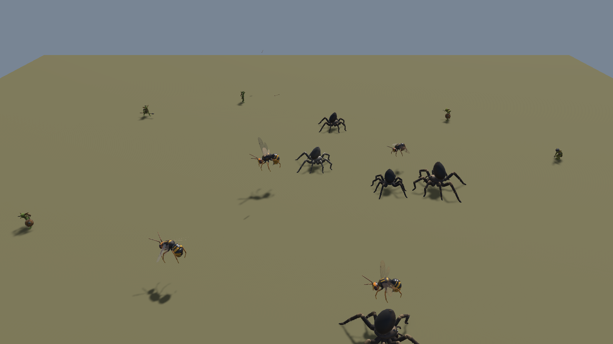
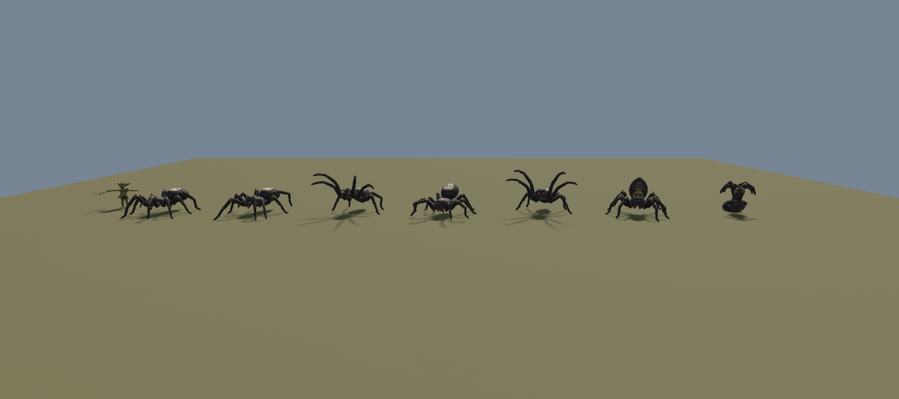
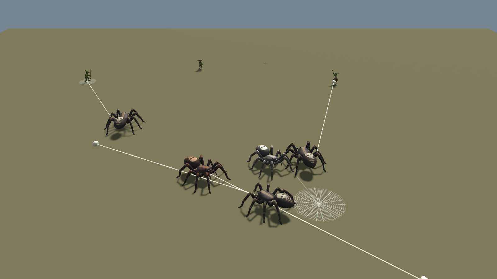
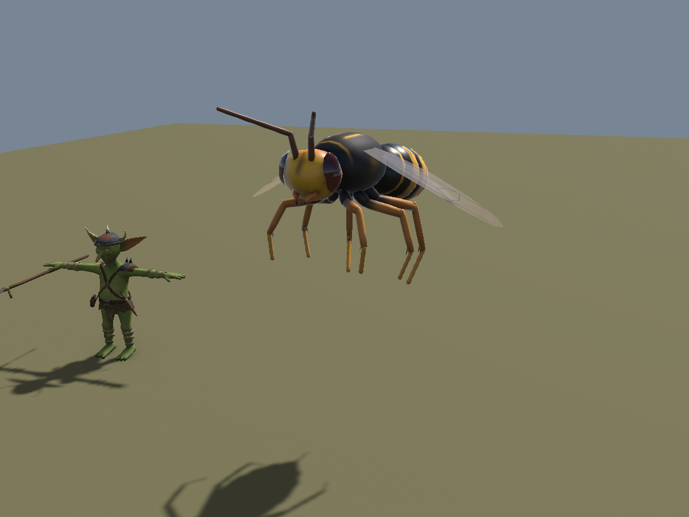
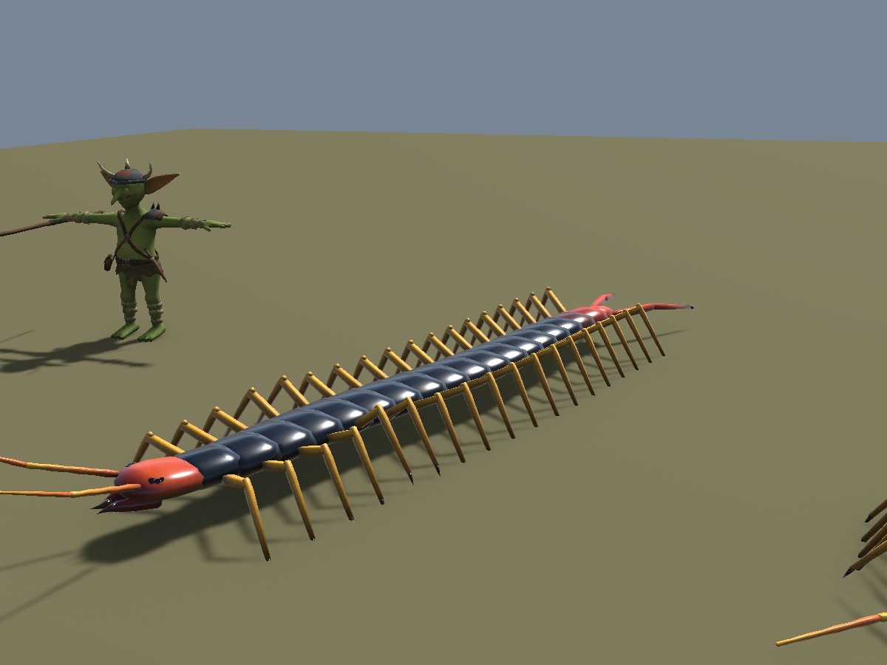
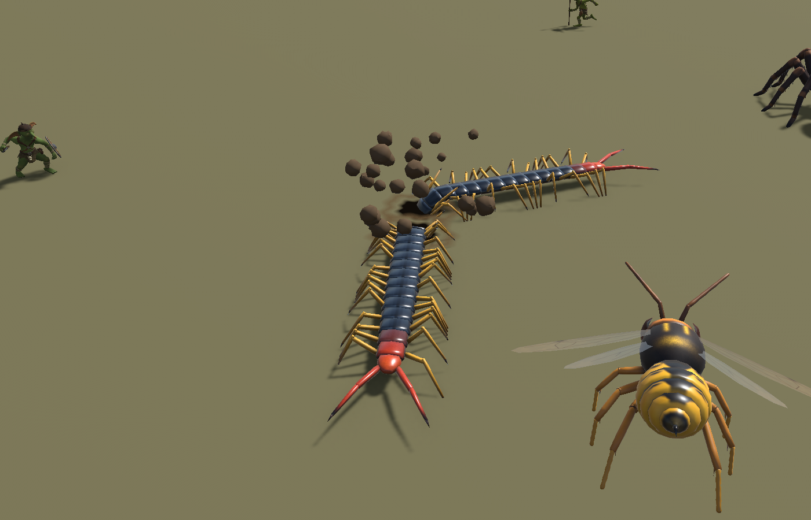

# Insectoids

Giant bugs for the colony sim, built procedurally in Blender: the **giant hunting spider**, the **giant wasp** and the
**giant centipede**.
The spider is horse-sized,
rideable (saddle socket), Unity Generic rig, hand-painted texture, nine custom clips. The leg IK, gait generator and
rigid-segment construction are meant to carry over to the next bugs (ants, beetles, mantis...).



Blender file: `blender/insectoids.blend` (saved compressed), scenes **Spider**, **Wasp** and **Centipede**. Everything in
it is rebuilt from `src/`.

## Rebuild

In Blender (Python console or the MCP):

```python
import sys; sys.path.insert(0, r"E:\Unity\Projects\GameArtGeneration\Insectoids\src")
import spider_build
spider_build.build_all()        # body -> rig -> UVs -> textures -> clips (~30 s)

import bug_export
bug_export.export_all()         # export/Spider.fbx, export/Anims/Spider@<clip>.fbx + spider_clips.json

import spider_anim
spider_anim.use("Walk")         # show a clip on the rig (sets the scene's frame range)
spider_anim.clear()             # back to the bind pose
```

| Script | Does |
|---|---|
| `bug_common.py` | lofted tubes that mark their own UV seams, domes (eyes), cones (spines, fangs), numpy value noise |
| `spider_body.py` | anatomy spec, planar leg IK, bind-pose bone table, the game mesh (rigid vertex groups per bone) |
| `bug_rig.py` | armature from the bone table, binding, pose math (armature-space matrices -> keyed matrix_basis) |
| `spider_paint.py` | seam-based unwrap, data bakes (position, normal, part, AO), per-texel painting, smoothness in alpha |
| `spider_anim.py` | SpiderPose -> bone matrices, key-pose tracks, the tetrapod gait, the nine clips |
| `bug_scene.py` | scene, cameras (incl. the 40 m colony camera), review renders and clip contact sheets |
| `spider_build.py` | `build_all()` |
| `bug_export.py` | FBX for Unity (goblin settings) and the clip metadata JSON (loop, root motion, events) |

## The spider




- **Size:** ~1.65 m from fangs to spinnerets, abdomen top 0.88 m, carapace 0.72 m, leg span ~3.2 m. Goblins are ~1 m.
- **Build:** an exoskeleton, so every part is a rigid shell on one bone. Each leg is five lofted segments (coxa,
  femur, patella+tibia, metatarsus, tarsus) whose rounded ends sit inside the flared end of the segment before, like
  real joints. Only the pedicel (waist) blends between Body and Abdomen. No heat-map weights, no bleeding between legs.
- **Look:** dark mottled brown, pale bands at the knees and ankles, a pale median stripe and radiating striae on the
  carapace, rust-red chelicerae, glossy black eyes, a bone-white skull with chevrons on the abdomen. The banding and
  the skull are what read from the colony camera.

### Budget

| Part | Triangles |
|---|---|
| Legs (8 x 5 segments) | 2,960 |
| Leg spines (macrosetae) | 384 |
| Abdomen / carapace / pedicel | 440 / 352 / 48 |
| Chelicerae + fangs / palps | 336 / 312 |
| Eyes (8) / spinnerets | 148 / 32 |
| **Total** | **5,012** |

One material, one 1024² texture (`T_Spider`, plus `T_Spider_Pale` for a washed-out cave variant). Alpha =
smoothness (URP Lit, Smoothness Source = Albedo Alpha): eyes 0.95, fangs 0.8, carapace 0.34, hair ~0.2.

### Skeleton (58 bones, Unity Generic)

`Motion` (root motion only; nothing hangs from it) beside `Root` (ground, never moves in the clips) > `Body` (cephalothorax) > `Abdomen` (at the pedicel), `CheliceraL/R` > `FangL/R`,
`PalpL/R_Femur/Tibia/Tarsus`, and eight legs `Leg{L|R}{1-4}_{Coxa|Femur|Tibia|Metatarsus|Tarsus}` (leg 1 in front).
Leg bones: +Y along the segment, +X the hinge, +Z dorsal; a positive X rotation raises a segment on either side.

### Sockets (props modelled in socket space: origin = attach point)

| Socket | Parent | Axes | For |
|---|---|---|---|
| Socket_Saddle | Body | +Y up, +Z forward, on top of the carapace | goblin rider's saddle |
| Socket_Mouth | Body | +Y forward, +Z up, between the fangs | carried prey, bite effects |
| Socket_Abdomen | Abdomen | +Y up, +Z forward, top of the abdomen | egg sac, armour, banner |
| Socket_Spinneret | Abdomen | +Y out of the spinnerets, +Z up | web-spit origin and direction |

### Clips (30 fps)

| Clip | Length | What happens | Event |
|---|---|---|---|
| `GetUp` | 1.33 s | from the Death end pose: pushes off, rolls back over, legs find the ground | |
| `Idle` | 3.0 s loop | breathing, abdomen pulse, palps and fangs twitch, L1 taps, R2 shifts | |
| `Walk` | 0.8 s loop | alternating tetrapod gait, root motion 1.25 m/s | |
| `Run` | 0.4 s loop | same gait, lower and faster, root motion 3.75 m/s | |
| `Hit` | 0.5 s | jolts back and up, legs flinch, fangs flare | |
| `Death` | 2.0 s | recoils, legs buckle, rolls onto its back, legs curl over the belly | Dead 1.75 s |
| `Bite` | 1.2 s | pulls back with front legs raised and fangs open, lunges 0.34 m, fangs strike | Bite 0.50 s |
| `Strike` | 1.33 s | rears ~20°, front legs up, slams them down ahead | Strike 0.73 s |
| `WebSpit` | 1.6 s | abdomen arches up over the back (skull facing the target), pumps, spits | Spit 0.67 s |
| `Threat` | 2.4 s | reared, front legs raised and spread, palps up, fangs flexing, sways | |

Event times are stored as custom properties on each action (`event_<Name>`). Walk and run are gait-generated
(`spider_anim.gait`): feet planted in the world during stance, rear legs leading. The other clips are key-pose tracks
interpolated per frame, with the leg IK solved every frame, so planted feet stay put while the body moves.

## Unity

Install into a Unity 6 URP project (MedievalSetting has it) with:

```
powershell -ExecutionPolicy Bypass -File tools\install_to_unity.ps1 -Project E:\Unity\Projects\MedievalSetting
```

It copies scripts, models, clips, the clip JSON and textures under `Assets/Insectoids` and keeps existing `.meta`
files. **Tools > Insectoids > Rebuild Spider** / **Rebuild Wasp** then build everything (each runs by itself the first
time); reports and renders go to `Logs/SpiderSetup` and `Logs/WaspSetup`. Shared editor code is in `InsectSetupUtil`.

| `Assets/Insectoids/...` | Contents |
|---|---|
| `Models/Spider.fbx` | Generic rig, avatar from this model, motion node `SpiderRig/Motion`, sockets kept (no Optimize Game Objects) |
| `Models/Anims/Spider@<clip>.fbx` | one clip each, avatar copied from Spider.fbx; loop, root motion (Walk, Run) and events from `spider_clips.json` |
| `Materials/` | `M_Spider` (+ `_Rust`, `_Dark` tints and `_Pale`), URP Lit, smoothness from albedo alpha; `M_Spider_Web`, `_Silk`, `_SilkThread` |
| `Prefabs/Spider_Giant` | Animator + `SpiderAppearance` + `SpiderCombat` |
| `Animation/SpiderAnims` | clip pools for `InsectRandomAnimator` |
| `Scenes/Insectoids_Test` | spiders, wasps and centipedes on random clips, 8 goblins around them (the spiders' prey, if the goblins are installed). Press Play. |

Runtime scripts (namespace `Insectoids`; no dependency on the goblin scripts):
- **`SpiderCombat`** receives the clip events (`OnSpiderEvent`: Bite, Strike, Spit, Dead) and raises `EventFired`
  (hook damage and sound there). On **Spit** it lobs a glob of silk from `Socket_Spinneret` on a ballistic arc to
  `target`, else the nearest `SpiderPrey` in front within `spitRange`, else a point ahead.
- **`SpiderWebGlob`** flies it, trailing a silk thread back to the spinnerets; **`SpiderWebSnare`** is the orb web it
  leaves where it lands (radius 1.3 m x size, 8 s). Gameplay hook: `SpiderWebSnare.Created`, `.All`,
  `SpiderWebSnare.IsSnared(position)` to slow or root units inside. Both are pooled.
- **`SpiderAppearance`** rolls a skin (Hunter x3, Rust, Dark, Pale) and a size (0.85-1.2x) per spider. The spider is
  one skinned mesh with one material already, so there is nothing to merge.
- **`InsectRandomAnimator`** + **`InsectAnimationSet`**: random pools through a playable graph with crossfades; root
  motion moves walking and running spiders, which meander and steer home. **`InsectTestUI`**: camera presets
  (colony 40 m / mid / close), labels, reshuffle, re-roll looks, and buttons that make every spider spit, bite,
  threaten... at once.

Verified in MedievalSetting: valid Generic avatar, 58 bones, 5,012 triangles, all clips and events imported; Walk
and Run root motion 1.25 and 3.75 m/s along the spider's forward (+Z), the body at a fixed offset from the GameObject
across loops (claw tips planted: 0.000 m/s slide in Blender over two loops); in Play mode the spiders walk, spit at the
goblins and leave webs, with no console errors.

## The wasp



Blender scene **Wasp** (same file). Rebuild with the Wasp scene on screen:

```python
import wasp_build
wasp_build.build_all()     # body + wings -> rig -> UVs and textures -> join -> clips (~15 s)
wasp_build.export()        # export/Wasp.fbx, export/Anims/Wasp@<clip>.fbx + wasp_clips.json
```

| Script | Does |
|---|---|
| `wasp_body.py` | anatomy, bone table, shells (head, thorax, petiole, six telescoping gaster plates, legs, mandibles, antennae) and the wing membranes |
| `wasp_paint.py` | `T_Wasp` painted per texel (bands, notches, face, thorax marks, amber legs); `T_Wasp_Wing` painted in wing space |
| `wasp_anim.py` | WaspPose -> bone matrices (forward kinematics), the eight clips; actions are named `Wasp_<clip>` |
| `wasp_build.py` | `build_all()`, `export()` |

- **Size:** ~1.5 m from mandibles to stinger, ~2.2 m wingspan, hovering with the thorax 1.7 m up (Root and Motion stay
  on the ground, so the pivot is under it and its shadow shows its height).
- **Build:** rigid shells again. The gaster is six plates on three bones (Gaster1-3) that telescope as it curls
  forward to sting. The wings are flat membranes on their own bones and a second material (transparent, both faces).
- **Look:** warning yellow and black bands with the black notch, yellow face, dark red eyes, black thorax with yellow
  marks, amber legs, smoky veined wings with a dark stigma. Skins in Unity: Wasp x3, Hornet (orange), Dark.

| Part | Triangles |
|---|---|
| Gaster plates + stinger | 1,240 |
| Legs (6 x 4 segments, spurs) | 1,788 |
| Head, eyes, ocelli, mandibles | 442 |
| Antennae | 432 |
| Thorax + petiole | 336 |
| Wings (4) | 42 |
| **Total** | **4,280** |

Skeleton (44 bones): `Motion` beside `Root` > `Body` (thorax) > `Head` (`MandibleL/R`, `AntennaL/R_Scape` >
`_Flagellum`), `Gaster1` > `Gaster2` > `Gaster3`, `ForewingL/R`, `HindwingL/R`, legs `Leg{L|R}{1-3}_{Coxa|Femur|Tibia|Tarsus}`.
Sockets: `Socket_Mouth` (Head), `Socket_Stinger` (Gaster3, +Y out of the stinger), `Socket_Saddle` (Body).

| Clip | Length | What happens | Event |
|---|---|---|---|
| `Idle` | 2.0 s loop | hover: bob, drift, abdomen pumping, legs and antennae swaying | |
| `Fly` | 1.0 s loop | nose down, legs trailing, root motion 4 m/s | |
| `Threat` | 1.6 s | abdomen curled forward and pumping, mandibles snapping, louder wings | |
| `Sting` | 1.3 s | rears back, lunges 0.45 m with the stinger forward | Sting 0.60 s |
| `Dive` | 1.8 s | climbs, dives to 0.65 m over the ground, stings, climbs back | Sting 0.90 s |
| `Hit` | 0.5 s | knocked back and rolled, wings stutter | |
| `Death` | 2.0 s | wings stop, falls, bounces, lies on its side with the legs curled | Dead 1.75 s |
| `GetUp` | 1.5 s | from the Death pose: wings start, rolls upright, climbs back to the hover | |

The wings flip between up and down stroke every frame (15 beats a second), which reads as a buzz; the hind wings
follow the forewings (they are hooked together in real wasps).

In Unity: **Tools > Insectoids > Rebuild Wasp** makes `Prefabs/Wasp_Giant` (Animator, `InsectAppearance`,
`InsectEvents`), `Animation/WaspAnims` and the materials; report and renders in `Logs/WaspSetup`. Animation events call
`OnInsectEvent(name)` on both creatures; `InsectEvents.EventFired` (wasp) and `SpiderCombat.EventFired` (spider) pass
them on.

**Test scene:** `Scenes/Insectoids_Test` (Tools > Insectoids > Build Test Scene; the creature setups rebuild it): 5
spiders, 4 wasps and 8 goblins. It replaces the spider-only `Insectoids_SpiderTest`.

## The centipede




Blender scene **Centipede** (same file). Rebuild with the Centipede scene on screen:

```python
import centipede_build
centipede_build.build_all()   # body -> rig -> UVs and texture -> clips (~20 s)
centipede_build.export()      # export/Centipede.fbx, export/Anims/Centipede@<clip>.fbx + centipede_clips.json
```

| Script | Does |
|---|---|
| `centipede_body.py` | anatomy, the body chain, two-bone leg IK, bone table, shells (head, 18 plates, tail, legs, antennae, forcipules) |
| `centipede_paint.py` | `T_Centipede`: blue-black plates with pale rims, ochre belly, red-orange head and tail end, yellow legs |
| `centipede_anim.py` | the path-following body, the metachronal leg wave, ten clips at 60 fps; actions `Centipede_<clip>` |
| `centipede_build.py` | `build_all()`, `export()` |

- **Size:** ~3.4 m long, trunk 0.17 m off the ground, ~1 m across the legs. Scolopendra-like warning colours.
- **Build:** a chain of 20 rigid elements (`Root > Head > Seg01 > ... > Seg18 > Tail`), each with a pair of two-bone
  legs (`Leg{L|R}{01-18}_{Femur|Tibia}`), long trailing `TailLeg{L|R}`, `Antenna{L|R}_1/_2`, `Forcipule{L|R}` (the venom
  claws), `Motion` for root motion. 107 bones, 5,448 triangles, one 1024² texture.
- **The body is a path:** each clip gives a direction field (sway, rear, curl, dive) that is integrated into a curve;
  every element sits at a fixed arc length behind the head, so the body never stretches. The skeleton plays in place;
  Motion carries the travel, at the ground actually gained along the swaying path (so the loop does not pop).
- **Legs:** a metachronal wave (each leg steps a fifth of a cycle after the one behind it, left and right half a cycle
  apart), feet planted in the world through IK; flailing where the body rears, tucked back along the body underground,
  curled in death.

| Clip | Length | What happens | Event |
|---|---|---|---|
| `Idle` | 3.0 s loop | slow S-sway, head searching, a ripple of leg steps down the body | |
| `Walk` / `Run` | 0.9 / 0.6 s loop | root motion 1.5 / 4 m/s (Run sways more) | |
| `Threat` | 2.5 s | the front rears like a cobra, head tipped down, legs flailing, claws snapping, tail legs up | |
| `Bite` | 1.2 s | rears, lunges 0.45 m, strikes with the forcipules | Bite 0.55 s |
| `Burrow` | 2.5 s | dives into the ground 0.55 m ahead and disappears; root motion carries the GameObject to the hole | Burrow 0.57 s |
| `Emerge` | 2.5 s | comes up out of the ground under the GameObject and crawls out until its tail leaves the hole; root motion follows the body | Emerge 0.58 s |
| `Hit` | 0.5 s | a jolt runs down the body | |
| `Death` | 2.0 s | rolls onto its back and curls up, legs curling | Dead 1.85 s |
| `GetUp` | 1.5 s | uncurls, rolls back over, stands | |

In Unity: **Tools > Insectoids > Rebuild Centipede** makes `Prefabs/Centipede_Giant` (Animator, `InsectAppearance`,
`InsectEvents`, `CentipedeBurrow`). `CentipedeBurrow` opens a dark hole and throws dirt clods at the Burrow / Emerge
events (`Burrowed` / `Emerged` events and `Underground` for gameplay). Burrow ends with the GameObject over the hole and
Emerge starts with the hole under it, so Burrow then Emerge in place uses one hole (checked: 7 cm apart); move the
GameObject while it is underground to surface elsewhere. In the test scene a burrowed centipede travels 3-8 m
underground (`InsectAnimationSet.Pool.relocate`) and comes back out 1.5 s later. Checked in Unity: Walk/Run root motion 1.5 / 4 m/s straight ahead with the head within 2 / 6 mm of its
place across loops; burrow effect and events in Play mode with no console errors.

## Repository

| Path | What |
|---|---|
| `src/` | the Blender Python that builds everything |
| `blender/insectoids.blend` | the working file (compressed, ~12 MB) |
| `export/` | Unity-ready FBX (`<Creature>.fbx`, `Anims/<Creature>@<clip>.fbx`) and the clip JSON |
| `textures/` | painted textures |
| `unity/Insectoids/` | the Unity scripts (`Runtime/`, `Editor/`) |
| `tools/install_to_unity.ps1` | copies all of it into a Unity project |
| `docs/images/` | the pictures in this README |
| `HANDOFF.md` | conventions, open issues and checks for whoever picks this up next |

Not in git: `renders/` (review renders) and Blender's `.blend1` backups.
